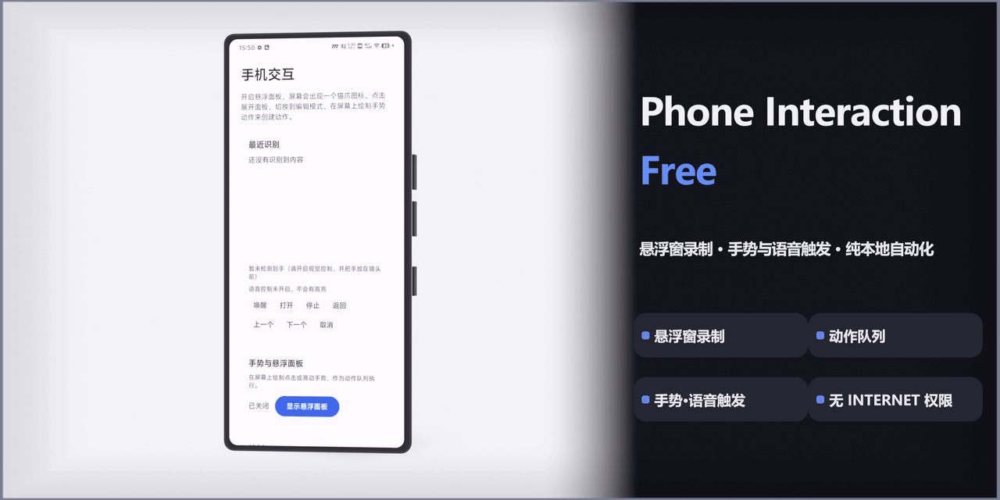
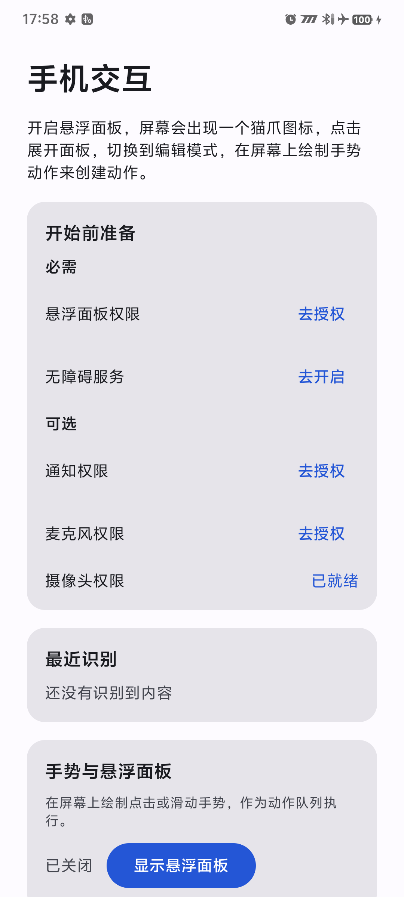
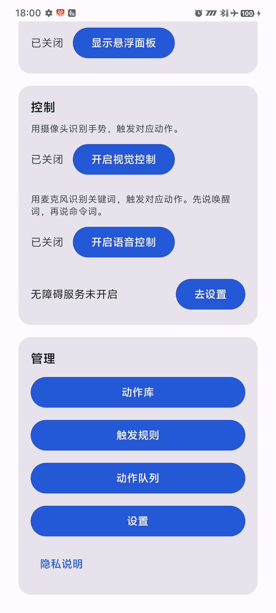
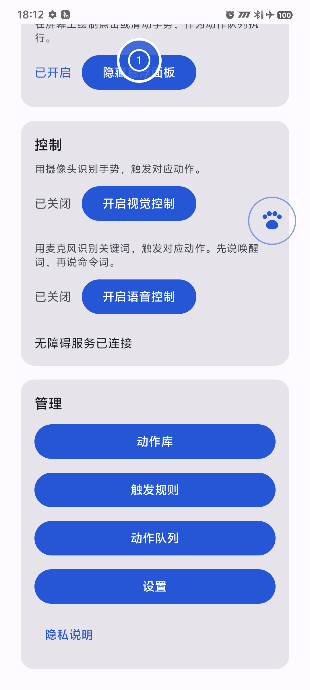
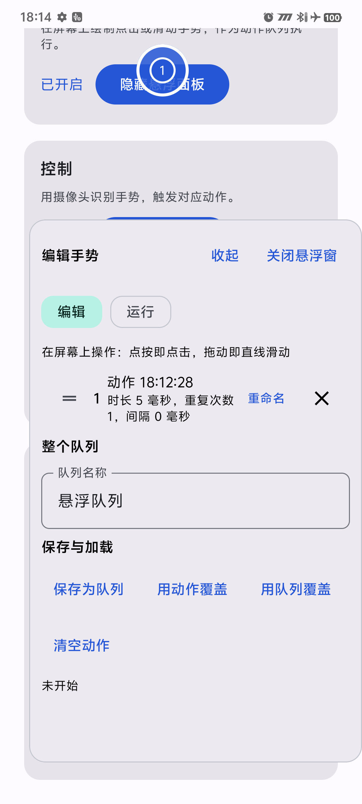
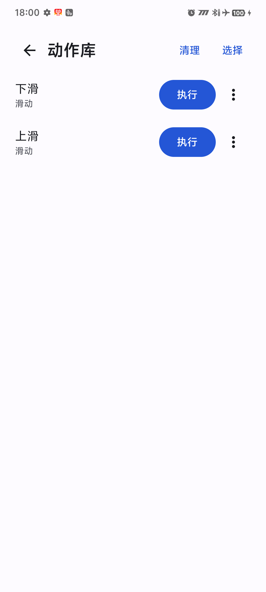
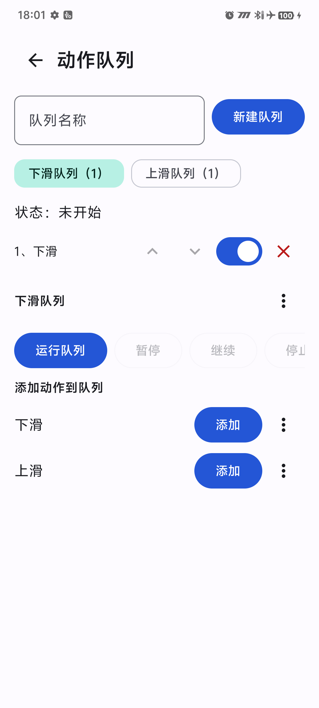
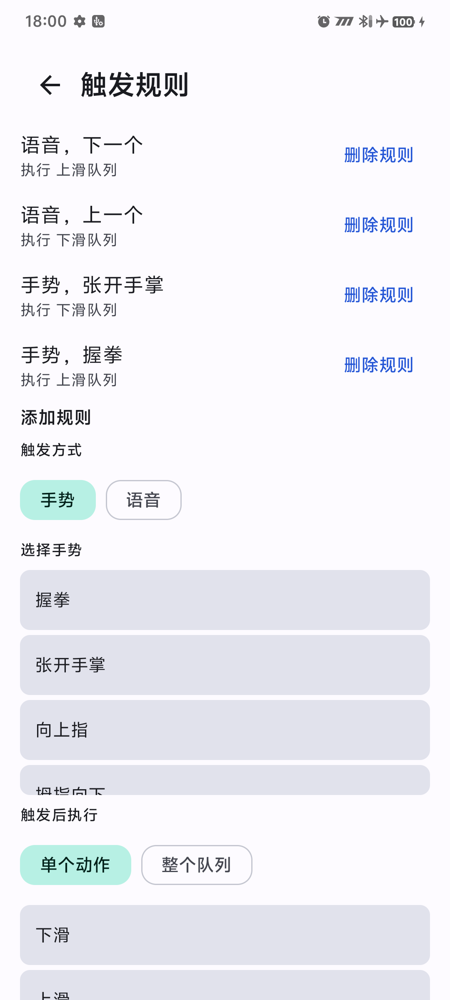
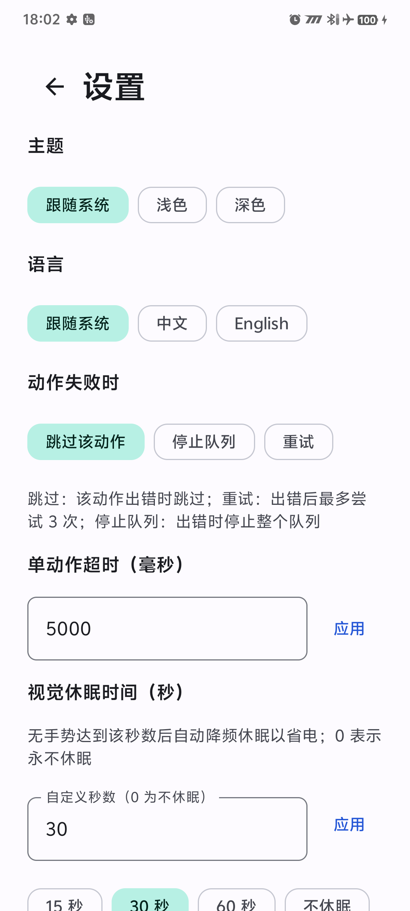

# Phone Interaction Free

<p align="center">
  
</p>

[English](README_EN.md) | 简体中文

> 授权协议：PolyForm Noncommercial 1.0.0（非商业用途免费使用、修改与分发；商业使用须事先取得书面授权）— 完整条款见 [LICENSE](LICENSE)

## 项目介绍

Phone Interaction Free 是一款基于 Android 无障碍服务（AccessibilityService）的设备自动化工具。它把"点击、滑动"这类操作封装成**动作**，把多个动作编排成**队列**，再用手势或语音**规则**触发它们。

核心设计取向：

- **本地优先**：动作、坐标、队列、规则与运行记录全部保存在本机；发布版本不申请 `INTERNET` / `ACCESS_NETWORK_STATE` 权限，应用内没有网络请求代码。
- **确定性自动化**：执行的是你预先录制的坐标与轨迹，不是黑盒 AI 决策；每一步做什么完全可查看、可修改。
- **无障碍驱动**：借用系统提供的无障碍接口完成点击与手势注入，因此需要用户显式开启无障碍服务。
- **多模态触发**：摄像头手势识别、离线语音唤醒词、以及悬浮窗内的直接编辑，三种方式可以混用。

## 功能

**动作（Action）**

- 点击与滑动两种基础动作；点击持续时间长即为长按；
- 每个动作可设置时长、前置等待与重复次数；
- 滑动记录为直线轨迹，执行时按按下 / 移动 / 抬起步骤回放；
- 单个动作默认超时 5000 毫秒，可在设置里调整。

**队列（Queue）**

- 把多个动作按顺序编排成一个队列；
- 支持队列级循环次数与启动延迟；循环次数设为 0 表示无限循环，若队列循环次数与动作重复次数同时为 0，会一直重复同一动作而不再进入下一轮；
- 运行中可暂停、继续或停止；暂停/继续仅在 App 中动作队列页面内可用；
- 动作执行失败后按设置里选择的策略处理（跳过该动作 / 停止整个队列 / 重试），其中重试最多尝试 3 次；
- 删除队列时，如果它引用的动作没有其它队列在用，会连带从动作库里一起删除。

**规则（Rule）**

- 手势触发：在摄像头画面中做出指定手势（如握拳、张掌）即可触发；
- 语音触发：说出唤醒词后说出命令词（如"下一个"）即可触发；
- 规则可以指向单个动作，也可以指向整个队列。

### 触发规则

**手势触发**（摄像头本地识别，无需联网）

| 手势 | Emoji | 说明 |
|---|---|---|
| 握拳 | ✊ | 握紧拳头 |
| 张开手掌 | 🖐️ | 五指伸直张开 |
| 向上指 | ☝️ | 食指竖起，其余收拢 |
| 拇指向下 | 👎 | 大拇指向下 |
| 拇指向上 | 👍 | 大拇指向上 |
| 剪刀手 | ✌️ | 食指与中指伸直呈 V 形 |
| 我爱你手势 | 🤟 | 拇指、食指、小指伸直 |

> 手势识别由内置的 MediaPipe 手势模型在本机完成，摄像头画面不会离开设备。

**语音触发**（离线唤醒词，先说唤醒词，再说命令词）

| 中文 | 拼音 | 英文 | IPA |
|---|---|---|---|
| 唤醒 | huàn xǐng | WAKE_UP | /weɪk ʌp/ |
| 打开 | dǎ kāi | OPEN | /ˈoʊpən/ |
| 停止 | tíng zhǐ | STOP | /stɒp/ |
| 返回 | fǎn huí | BACK | /bæk/ |
| 上一个 | shàng yī gè | PREVIOUS | /ˈpriːviəs/ |
| 下一个 | xià yī gè | NEXT | /nɛkst/ |
| 取消 | qǔ xiāo | CANCEL | /ˈkænsəl/ |

> 英文命令词按上表的 IPA 音标发音；界面语言为英文时只识别英文词，为中文时只识别中文词。

**悬浮窗编辑（Overlay）**

- 在任意应用画面上点按录制点击，拖拽录制直线滑动；
- 在悬浮窗中查看并修改队列参数与运行状态；
- 悬浮窗三种状态下的触摸行为：
  - **折叠态**（右侧 56dp 猫爪）：点击即展开面板，触摸被拦截；
  - **展开态**（编辑面板）：面板区域完全拦截触摸，可编辑队列 / 运行状态；
  - **运行态**（面板隐藏）：顶部 240dp 进度胶囊不拦截，全屏 1×1 透明层旁路监听，**轻触屏幕任何位置即停止队列**，触摸仍透传给目标应用不消费。

**语音与手势识别**

- 语音唤醒：基于离线关键字唤醒模型（sherpa-onnx），模型文件随应用打包，录音不上传；命中唤醒词仅唤醒视觉识别，不作为命令执行；
- 手势识别：基于随包打包的手势识别模型，识别在你的设备上本地完成；
- 视觉识别无手势持续设定秒数后自动降频休眠（默认 30 秒，可在设置改为 15/30/60 秒或不休眠），首页有「立即唤醒」按钮可手动恢复。

**运行记录**

- 记录每次动作执行的类型、结果与时间；
- 仅保留最近 200 条记录，日志保存在本机，可随时清空。

**其它**

- 界面支持简体中文 / English 切换，并提供浅色、深色、跟随系统三种主题；
- 所有数据都在本机，可通过系统设置的应用管理单独清除。

## 界面预览

| 首页 | 管理与控制 | 悬浮按钮 | 悬浮编辑面板 |
|:---:|:---:|:---:|:---:|
|  |  |  |  |

| 动作库 | 动作队列 | 触发规则 | 设置 / 执行记录 |
|:---:|:---:|:---:|:---:|
|  |  |  |  |

## 安装与启用

### 1. 系统要求

- Android 12（API 31）或更高版本；
- 仅提供 arm64-v8a 与 armeabi-v7a 两种架构 APK，请在设置/终端查看 CPU 架构后下载对应包；
- 所有界面强制竖屏，不支持横屏；
- 一个可以接收你亲自点击的设备（应用不提供远程控制通道）。

### 2. 安装

1. 获取与你的系统架构匹配的**已签名** APK 安装包；
2. 系统会提示"禁止安装未知应用"，按提示允许当前使用的浏览器或文件管理器安装应用即可；
3. 安装完成后打开应用。

> Android 13 及以上版本，侧载安装的应用默认不允许开启无障碍服务，需要额外做一步受限设置放开，见下一节。

### 3. 开启无障碍服务（必做）

1. 首次启动时，应用会先展示无障碍服务用途披露，阅读并同意后进入主界面；
2. 在主界面点击"去设置"，系统会跳转到系统的辅助功能设置页面；
3. 在列表中找到 "Phone Interaction" 并开启；
4. 回到应用，状态会刷新为"已连接"。

**Android 13+ 侧载用户**：如果列表里找不到本服务，或开关是灰色的，请打开

```
设置 → 应用 → 特殊应用权限 → 受限设置 → Phone Interaction → 允许受限设置
```

然后回到辅助功能设置页重新开启。

> 应用只借用无障碍接口执行你自己配置的点击与手势，不读取屏幕内容、不监听其他应用的事件流。

### 4. 按需授予其它权限

| 权限 | 何时需要 | 不授予的后果 |
|---|---|---|
| 通知（Android 13+） | 开启任一前台功能前 | 前台服务通知不会显示（Android 13+ 要求通知权限），功能仍可运行；但后台可能更易被系统限制 |
| 悬浮窗 | 使用悬浮窗编辑动作坐标 | 悬浮窗无法显示，录制坐标不可用 |
| 摄像头 | 使用手势触发规则 | 手势识别不可用，其余功能不受影响 |
| 麦克风 | 使用语音触发规则 | 语音唤醒不可用，其余功能不受影响 |

授予权限后，请回到应用按功能开关启动对应能力。摄像头与麦克风画面、音频都在设备本地实时处理，不会保存、不会上传。

### 5. 首次使用建议

1. 在悬浮面板中绘制一个点击或滑动动作；
2. 在"队列"页把动作加入队列，设置循环次数；
3. 在"规则"页新建一条手势或语音规则，指向该队列；
4. 开启悬浮窗，回到目标应用，用悬浮窗录制需要点击的位置。

首次启动时应用会预置两条上下滑动队列，以及握拳 / 张掌的手势规则和"上一个 / 下一个"的语音规则，可以直接试用或删除。

## 权限说明与隐私

**权限用途一览**

- **无障碍服务**：执行点击、滑动与多步骤轨迹；这是应用工作的前提。
- **悬浮窗**：在其它应用之上显示编辑面板与运行状态。
- **摄像头**：本地手势识别，仅在你开启手势触发时使用。
- **麦克风**：本地语音唤醒，仅在你开启语音触发时使用。
- **通知（Android 13+）**：展示前台服务通知，以及运行中的停止入口。

**隐私说明**

- 摄像头画面与麦克风音频**只在设备本地实时处理**，不落盘、不上传；
- 动作、坐标、队列、规则、执行记录等配置与历史数据**全部保存在本机**，随应用数据一起存放；
- 发布版本不包含网络权限，不上传任何遥测或崩溃数据；
- 应用内没有广告与统计 SDK；
- 卸载应用、在系统设置中"清除数据"、或改用不同签名重新安装，都会**不可恢复地**删除上述本地数据；
- 自动化操作由你自行配置与发起，请自行承担在目标应用中的操作后果。

## 支持与打赏

如果这个项目对你有帮助，欢迎自愿打赏支持开发。你的支持不会解锁任何功能，也不会影响使用体验。


- 左：支付宝收款码；
- 右：微信支付收款码。

> 收款码图片的著作权与相关信息归作者所有，仅在本项目内展示，不作为可复用素材授权。

---

## 授权与免责

本项目采用 **PolyForm Noncommercial 1.0.0** 授权：允许非商业用途的免费使用、修改与分发；任何商业用途（收费产品、商业服务、公司内部商用集成、随商业产品分发等）必须事先取得作者的书面授权。完整条款见 [LICENSE](LICENSE)。

作者不对软件提供任何担保；自动化与无障碍点击可能命中错误目标，由此产生的一切后果由使用者自行承担。
