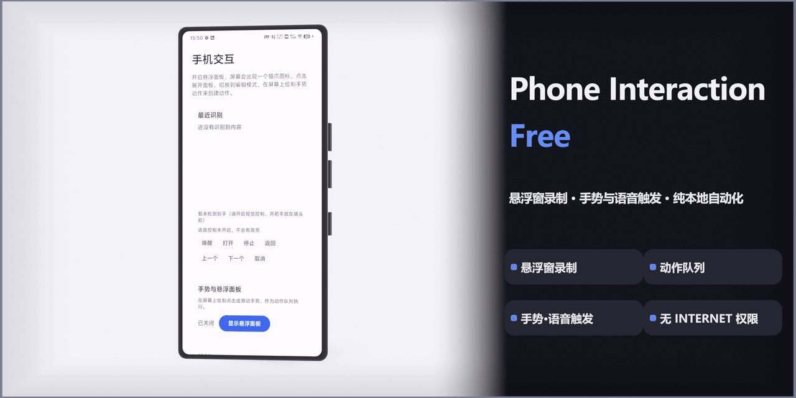
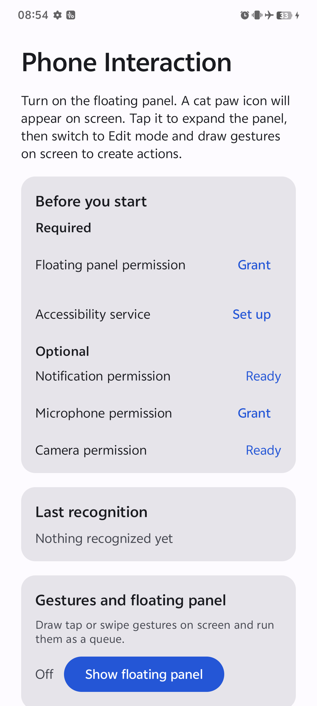
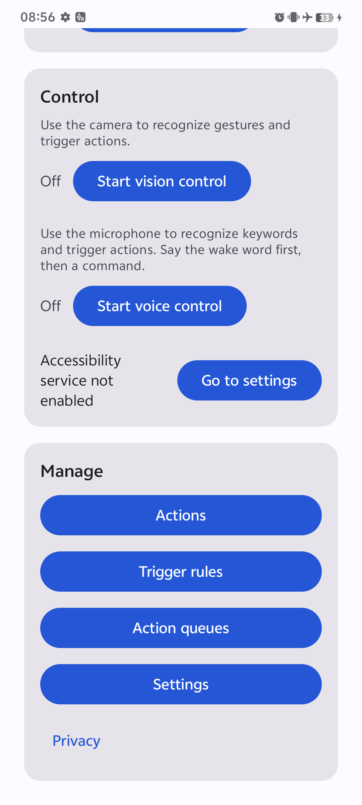
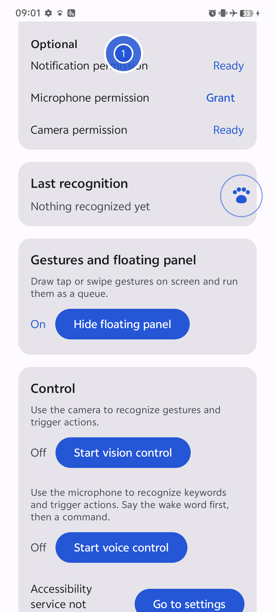
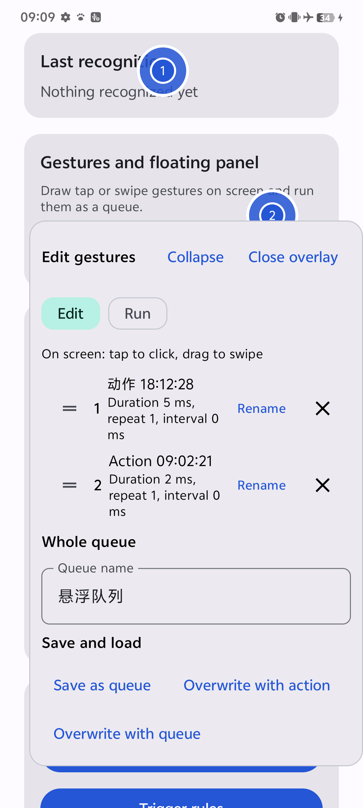
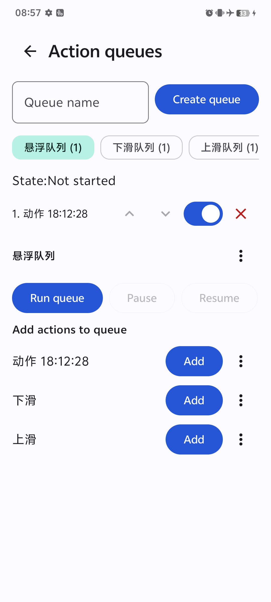
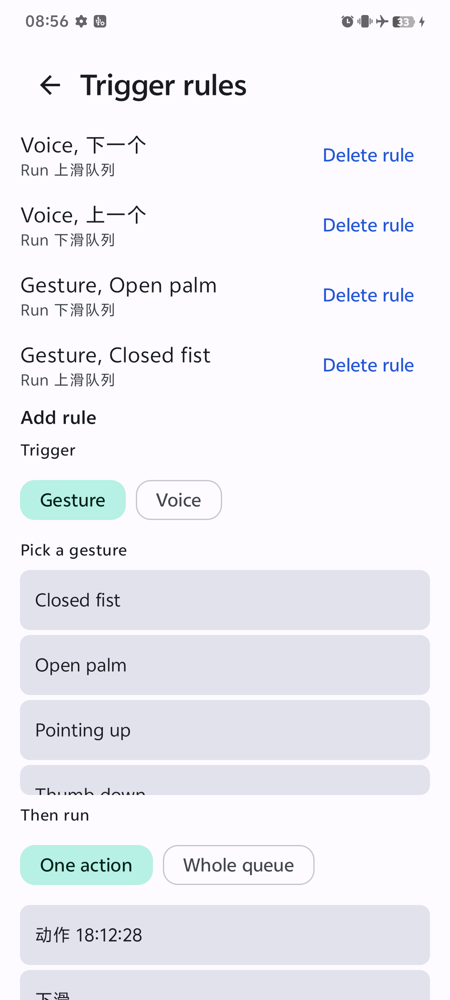
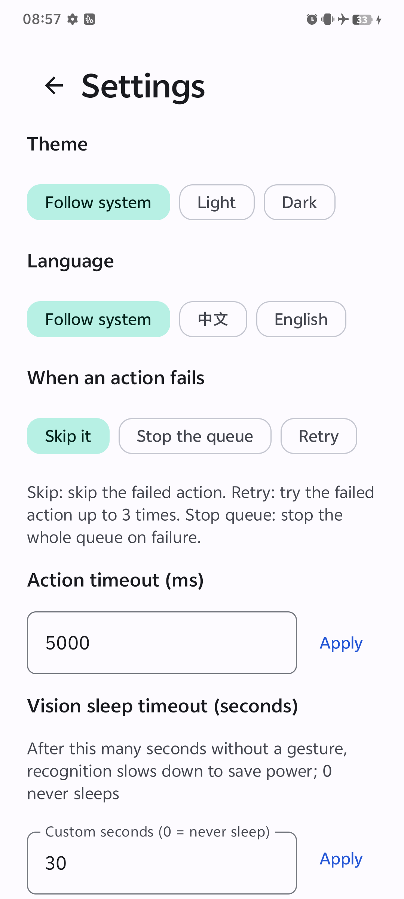

# Phone Interaction Free

<p align="center">
  
</p>

English | [简体中文](README.md)

> License: PolyForm Noncommercial 1.0.0 (free use, modification and distribution for noncommercial purposes; any commercial use requires prior written authorization) — full terms in [LICENSE](LICENSE)

## Project Overview

Phone Interaction Free is a device-automation tool for Android built on the system AccessibilityService. It turns "tap, swipe" style operations into **actions**, arranges multiple actions into **queues**, and triggers them with **rules** based on gestures or voice.

Core design principles:

- **Local first**: actions, coordinates, queues, rules and execution history are stored only on your device. The shipped release does not request the `INTERNET` / `ACCESS_NETWORK_STATE` permissions and contains no networking code.
- **Deterministic automation**: it replays the coordinates and trajectories you recorded, not opaque AI decisions. Every step is inspectable and editable.
- **Accessibility-driven**: it relies on the platform accessibility APIs to dispatch taps and gestures, so you must explicitly enable the accessibility service.
- **Multiple trigger modalities**: camera gesture recognition, offline voice wake word, and direct editing in the overlay can be combined freely.

## Features

**Actions**

- Two primitive action types: tap and swipe; a long tap (held for a long time) behaves as a long press;
- Per-action duration, pre-delay and repeat count;
- Swipe is recorded as a straight-line trajectory and replayed as pointer down / move / up steps.

**Queues**

- Order several actions into a queue;
- Queue-level loop count and start delay; setting the loop count to 0 means infinite — if both the queue loop count and the action repeat count are 0, the same action repeats forever without advancing to the next cycle;
- Pause, resume and stop while running; pause/resume are only available in the Queue screen in the app;
- When an action fails, the behavior follows the strategy you selected in settings (skip the action / stop the whole queue / retry). The retry option attempts at most 3 times;
- Deleting a queue also removes its actions from the action library if no other queue references them.

**Rules**

- Gesture triggers: perform a gesture in the camera preview (fist, palm, …) to fire a rule;
- Voice triggers: say the wake word followed by a command word ("next") to fire a rule;
- A rule can point to a single action or to a whole queue.

### Trigger Rules

**Gesture triggers** (on-device camera recognition, no network)

| Gesture | Emoji | Description |
|---|---|---|
| Closed fist | ✊ | Hand clenched into a fist |
| Open palm | 🖐️ | All five fingers extended and spread |
| Pointing up | ☝️ | Index finger extended, others folded |
| Thumb down | 👎 | Thumb pointing downward |
| Thumb up | 👍 | Thumb pointing upward |
| Victory sign | ✌️ | Index and middle finger forming a V |
| I love you | 🤟 | Thumb, index and pinky extended |

> Gesture recognition runs entirely on the device using the bundled MediaPipe gesture model. Camera frames never leave the device.

**Voice triggers** (offline wake word; say the wake word first, then the command word)

| English | IPA |
|---|---|
| WAKE_UP | /weɪk ʌp/ |
| OPEN | /ˈoʊpən/ |
| STOP | /stɒp/ |
| BACK | /bæk/ |
| PREVIOUS | /ˈpriːviəs/ |
| NEXT | /nɛkst/ |
| CANCEL | /ˈkænsəl/ |

> Speak the English command words using the IPA above. When the UI language is English only English words are recognized; when it is Chinese only Chinese words are recognized.

**Overlay editing**

- Tap on any app screen to record a tap action; drag to record a straight-line swipe;
- Review and edit queue parameters and run state from the overlay;
- The overlay's touch behavior in its three states:
  - **Collapsed** (56 dp cat-paw button on the right edge): tap to expand the panel (touch is intercepted);
  - **Expanded** (editing panel): the panel area fully intercepts touches for editing queue / run state;
  - **Running** (panel hidden): the top 240 dp progress capsule does not intercept touches; a full-screen 1×1 transparent layer watches for the first touch — tap anywhere on screen to stop the queue (touch still passes through to the target app, not consumed).

**Voice and gesture recognition**

- Voice wake-up powered by an offline keyword-spotting model (sherpa-onnx); the model ships inside the app and no audio leaves the device; hitting the wake word only wakes the vision pipeline, it is not executed as a command;
- Gesture recognition powered by a bundled hand-gesture model, executed locally on your device;
- Vision recognition automatically lowers its frequency after a configurable idle period (default 30 s, adjustable to 15/30/60 s or never), and the home screen shows a "Wake now" button to resume immediately.

**Execution history**

- Records the type, result and time of every executed action;
- Only the most recent 200 entries are kept, stored locally and can be cleared at any time.

**Misc**

- UI available in Simplified Chinese and English, with light, dark and follow-system themes;
- All data lives on the device and can be wiped independently through system app management.

## Screenshots

| Home | Controls & Management | Overlay Button | Overlay Editor |
|:---:|:---:|:---:|:---:|
|  |  |  |  |

| Actions | Queues | Rules | Settings / History |
|:---:|:---:|:---:|:---:|
|  |  |  |  |

## Installation and Setup

### 1. Requirements

- Android 12 (API 31) or newer;
- Only arm64-v8a and armeabi-v7a APKs are provided; check your device's CPU architecture (in Settings or via terminal) before downloading;
- All screens are forced to portrait orientation; landscape is not supported;
- A device you can physically interact with (the app provides no remote-control channel).

### 2. Install

1. Obtain a **signed** APK package matching your system architecture;
2. Your system will warn about installing unknown apps — allow the browser or file manager you are using to install it;
3. Open the app after installation.

> On Android 13 and newer, side-loaded apps are blocked from enabling accessibility services by default. One extra step is required — see the next section.

### 3. Enable the accessibility service (required)

1. On first launch the app shows an accessibility disclosure; read it and accept to reach the home screen;
2. Tap **Open settings** — the system opens the Accessibility settings page;
3. Find "Phone Interaction" in the list and switch it on;
4. Return to the app; the status refreshes to "connected".

**Side-loaded users on Android 13+**: if the service is missing from the list, or the switch is greyed out, open

```
Settings → Apps → Special app access → Restricted settings → Phone Interaction → Allow restricted settings
```

then go back to Accessibility settings and enable the service again.

> The app only uses the accessibility APIs to perform the taps and gestures you configured. It does not read screen content and does not subscribe to other apps' event streams.

### 4. Grant the other permissions you need

| Permission | Needed when | Consequence of not granting |
|---|---|---|
| Notifications (Android 13+) | Before enabling any foreground feature | The foreground service notification won't show (Android 13+ requires notification permission); the feature still runs but may be more restricted in the background |
| Display over other apps | To use the overlay for coordinate recording | The overlay cannot be shown, coordinate recording is unavailable |
| Camera | To use gesture-triggered rules | Gesture recognition is unavailable; everything else still works |
| Microphone | To use voice-triggered rules | Voice wake-up is unavailable; everything else still works |

After granting a permission, return to the app and start the corresponding capability with its own switch. Camera frames and microphone audio are processed in real time on the device only — never stored, never uploaded.

### 5. First run tips

1. In the overlay panel, draw a tap or swipe action;
2. On the "Queues" screen, add the action to a queue and set a loop count;
3. On the "Rules" screen, create a gesture or voice rule pointing at that queue;
4. Enable the overlay, switch to your target app, and record the positions you need to tap.

On first launch the app pre-seeds two swipe queues (up and down), plus fist / palm gesture rules and "previous / next" voice rules, so you can try it out or delete them right away.

## Permissions and Privacy

**Permission purposes**

- **Accessibility service**: performs taps, swipes and multi-step trajectories; this is the prerequisite for the app to work.
- **Display over other apps**: shows the editing panel and run state above other apps.
- **Camera**: local gesture recognition, used only while gesture triggering is enabled.
- **Microphone**: local voice wake-up, used only while voice triggering is enabled.
- **Notifications (Android 13+)**: shows the foreground service notification and the stop control while running.

**Privacy**

- Camera frames and microphone audio are **processed in real time on the device only** — never written to disk, never uploaded;
- Actions, coordinates, queues, rules and execution history are **stored locally** alongside the app's data;
- The shipped release ships without network permissions and uploads no telemetry or crash reports;
- There are no advertising or analytics SDKs in the app;
- Uninstalling the app, using "clear data" in system settings, or reinstalling with a different signing key will **irrecoverably delete** that local data;
- You configure and trigger every automation yourself; you bear the consequences of the resulting actions inside third-party apps.

## Support and Donation

If this project is useful to you, a voluntary donation is welcome to support continued development. Donations unlock no features and do not change your experience.


- Left: Alipay QR code;
- Right: WeChat Pay QR code.

> The QR code image and the associated payment details remain the author's property. They are shown within this project only and are not licensed for reuse.

---

## License and Disclaimer

This project is licensed under the **PolyForm Noncommercial 1.0.0**: free use, modification and distribution are allowed for noncommercial purposes, while any commercial use (paid products, commercial services, internal commercial integration, redistribution as part of a commercial offering, …) requires the author's prior written authorization. Full terms are in [LICENSE](LICENSE).

The software is provided without warranty of any kind. Automation and accessibility-driven clicks may hit the wrong target; you bear all consequences.
